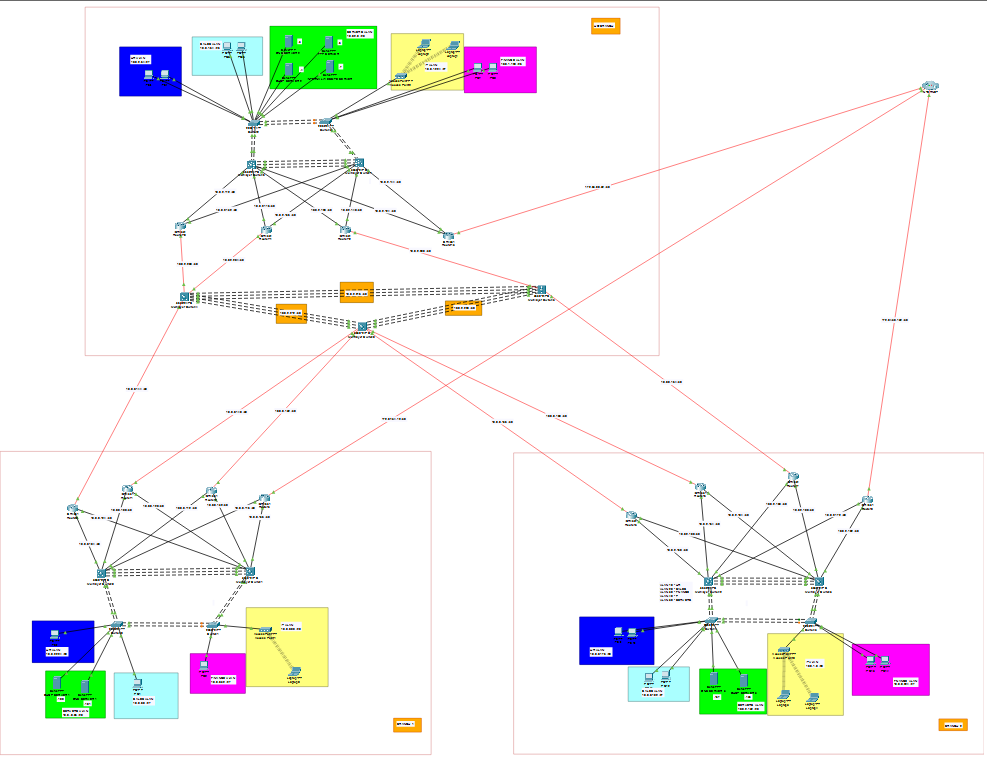
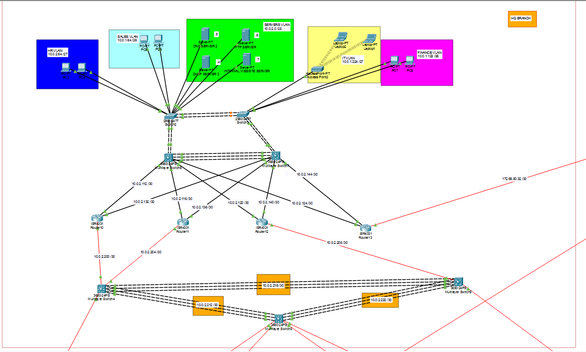

# Multi-Site Enterprise Network: OSPF Multi-Area, HSRP, EtherChannel and NAT/PAT

A three-site enterprise network designed, configured and tested in **Cisco Packet Tracer**. A headquarters and two branch offices are connected through a redundant routed core running **multi-area OSPF**, with **HSRP** gateways, **LACP EtherChannel**, **VLAN segmentation**, **DHCP relay**, **DNS/web/FTP services** and **PAT** for internet access.

> **Academic project.** Group assignment for *CIS3202 Switching and Routing Protocols* (Bachelor of Computer Science, INTI International University). This is a simulated lab network.

## Network topology

### Full topology

The whole network on one page: the three sites and how they connect through the redundant core.



### Headquarters

A closer look at the headquarters site.



### Branch 1


### Branch 2


## At a glance

| | |
|---|---|
| Sites | 3 (Headquarters, Branch 1, Branch 2) |
| Routers per site | 4 (3 internal routers + 1 edge router) |
| Core | 3 central Layer 3 switches at HQ, connected in a triangle |
| Switching per site | 2 Layer 3 distribution switches + 2 Layer 2 access switches |
| VLANs per site | 5 (HR, Sales, Finance, IT, Servers) |
| Routing | OSPF, 4 areas (0 to 3) |
| Tools | Cisco Packet Tracer 9.0.0 |

## What was implemented

- **Hierarchical design:** access, distribution and routed core layers at every site.
- **VLANs and inter-VLAN routing:** VLANs 10/20/30/40/50 on all switches, 802.1Q trunks, and Layer 3 SVIs on the distribution switches.
- **First-hop redundancy:** HSRP on every SVI. SW1 is active (priority 110, preempt) and SW2 is standby (priority 100). Hosts receive the HSRP virtual IP as their gateway through DHCP.
- **EtherChannel (LACP):** port-channels between distribution switches and from each access switch to both distribution switches. At HQ, the three core switches are linked by routed EtherChannel, so there is no Spanning Tree at the core.
- **Redundant WAN core:** every branch internal router connects to the core switches over routed /30 Gigabit point-to-point links in a zig-zag pattern, so no single router or core switch is a single point of failure.
- **Multi-area OSPF:** explicit router IDs, per-site areas, and default-route containment (see below).
- **Internet access:** one edge router per site runs PAT (NAT overload) toward a simulated ISP router, with a static default route redistributed into OSPF using `default-information originate`.
- **Services:** DHCP with `ip helper-address`, DNS, an internal HTTP/HTTPS web portal and an FTP server at HQ, plus a local DHCP and DNS server at each branch.

## IP addressing (VLSM)

All sites use the 10.0.0.0/8 private space with variable-length subnets sized per department. VLAN 10 is HR, 20 is Sales, 30 is Finance, 40 is IT and 50 is Servers. The gateway is the HSRP virtual IP.

**Headquarters**

| VLAN | Department | Subnet | Gateway |
|---|---|---|---|
| 10 | HR | 10.0.2.64/27 | 10.0.2.65 |
| 20 | Sales | 10.0.1.64/26 | 10.0.1.65 |
| 30 | Finance | 10.0.1.128/26 | 10.0.1.129 |
| 40 | IT | 10.0.1.224/27 | 10.0.1.225 |
| 50 | Servers | 10.0.2.0/28 | 10.0.2.1 |

**Branch 1**

| VLAN | Department | Subnet | Gateway |
|---|---|---|---|
| 10 | HR | 10.0.2.224/28 | 10.0.2.225 |
| 20 | Sales | 10.0.0.0/27 | 10.0.0.1 |
| 30 | Finance | 10.0.0.32/27 | 10.0.0.33 |
| 40 | IT | 10.0.0.80/28 | 10.0.0.81 |
| 50 | Servers | 10.0.0.96/29 | 10.0.0.97 |

**Branch 2**

| VLAN | Department | Subnet | Gateway |
|---|---|---|---|
| 10 | HR | 10.0.0.176/28 | 10.0.0.177 |
| 20 | Sales | 10.0.0.192/27 | 10.0.0.193 |
| 30 | Finance | 10.0.0.224/27 | 10.0.0.225 |
| 40 | IT | 10.0.1.0/28 | 10.0.1.1 |
| 50 | Servers | 10.0.2.152/29 | 10.0.2.153 |

Router-to-core and core-to-core links use /30 point-to-point subnets.

## OSPF multi-area design

| Area | Scope |
|---|---|
| **0** (backbone) | The three core L3 switches and the uplinks of the internal routers at every site |
| **1** | HQ: distribution switches, internal routers and edge router |
| **2** | Branch 1 |
| **3** | Branch 2 |

The internal routers sit on the border between Area 0 and their site's area. Each site's edge router originates the default route **inside that site's own area only**, so every site uses its own internet exit. Without this containment, Branch 1 could send internet traffic out through Branch 2's edge router.

## Configuration excerpts

HSRP and DHCP relay on an HQ distribution switch SVI:

```
interface Vlan10
 ip address 10.0.2.66 255.255.255.224
 ip helper-address 10.0.2.4
 standby 1 ip 10.0.2.65
 standby 1 priority 110
 standby 1 preempt
```

PAT, default route and OSPF default-route origination on the HQ edge router:

```
interface GigabitEthernet0/0/2
 ip address 172.65.80.33 255.255.255.252
 ip nat outside
!
router ospf 1
 router-id 23.23.23.23
 network 10.0.2.124 0.0.0.3 area 1
 network 10.0.2.144 0.0.0.3 area 1
 default-information originate
!
ip nat inside source list PAT interface GigabitEthernet0/0/2 overload
ip route 0.0.0.0 0.0.0.0 172.65.80.34
```

## Testing and verification

| Test | Result |
|---|---|
| Inter-VLAN ping (Branch 1 Finance to Branch 1 Sales) | Success |
| Inter-branch ping (HQ Sales to Branch 1 Finance) over OSPF-learned routes | Success |
| DHCP leases through the relay on each site and VLAN | Success |
| DNS resolution (`nslookup`) from HQ and branch hosts | Success |
| Internal web portal reached from a branch PC | Success |
| Internet access through PAT (`show ip nat translations`) | Success |
| OSPF adjacencies in FULL state (`show ip ospf neighbor`) | Success |
| One core switch shut down: OSPF reconverged and traffic rerouted via the other two | Success |
| One internal router disabled: connectivity maintained | Success |
| Default route from one site absent from another site's routing table | Success |

Commands used throughout: `ping`, `traceroute`, `show ip ospf neighbor`, `show ip ospf interface`, `show ip route`, `show ip nat translations`, `show vlan brief`, `show interfaces trunk`, `show standby brief`, `show etherchannel summary`, `show ip dhcp binding`, `show cdp neighbors`, `show cdp neighbors detail`, `show running-config`, `show run | section ospf`.

## Troubleshooting guide (summary)

| Symptom | Likely cause | First checks |
|---|---|---|
| Host gets no DHCP lease | Missing `ip helper-address`, wrong pool | `show ip interface`, ping the DHCP server from the SVI |
| No ping between VLANs | `ip routing` off, VLAN missing, trunk not allowing the VLAN, SVI down | `show vlan brief`, `show interfaces trunk`, `show ip interface brief` |
| Inter-branch ping fails | Adjacency down, wrong network statement or area | `show ip ospf neighbor`, check network statements |
| No internet | NAT inside/outside wrong, ACL mismatch, no default route | `show ip nat translations`, `show access-lists`, `show ip route` |
| Default route in the wrong area | Edge router placed in Area 0 | Check the edge router's OSPF network statements |
| HSRP does not fail over | Missing `preempt`, priorities wrong | `show standby brief` |
| EtherChannel not forming | LACP mode or speed/duplex mismatch | `show etherchannel summary` |
| OSPF stuck in EXSTART/EXCHANGE | IP address conflict on the link, duplicate router ID | `show ip ospf neighbor`, `show ip interface brief` on both ends, `show ip ospf` to compare router IDs |

## Repository contents

```
.
├── .gitignore                          
├── README.md
├── Multi-Site Enterprise Network.pkt   Packet Tracer file (built with Packet Tracer 9.0.0)
├── full_topology.png                   Full network topology
├── HQ_Branch_topology.png              Headquarters topology
├── Branch 1_topology.png               Branch 1 topology
└── Branch 2_topology.png               Branch 2 topology
```

**To open the lab:** install Cisco Packet Tracer 9.0.0 or newer and open `Multi-Site Enterprise Network.pkt`. Older versions of Packet Tracer cannot open files saved in a newer version.

## Notes

- No passwords were configured on the routers and switches. This was an intentional design choice for ease of access in the lab. A production network would use authentication, encrypted passwords and SSH.
- Each site has a single edge router. A two-edge-router design was tried, but Packet Tracer could not advertise the default routes with different priorities, so each site uses one.
- The ISP and internet side, including the public-looking addresses, is simulated inside Packet Tracer.
